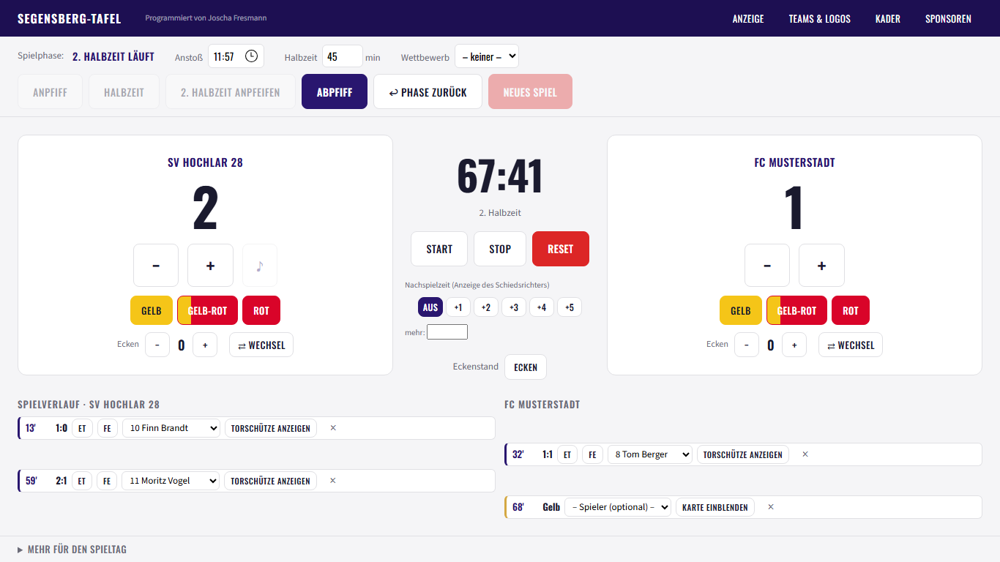
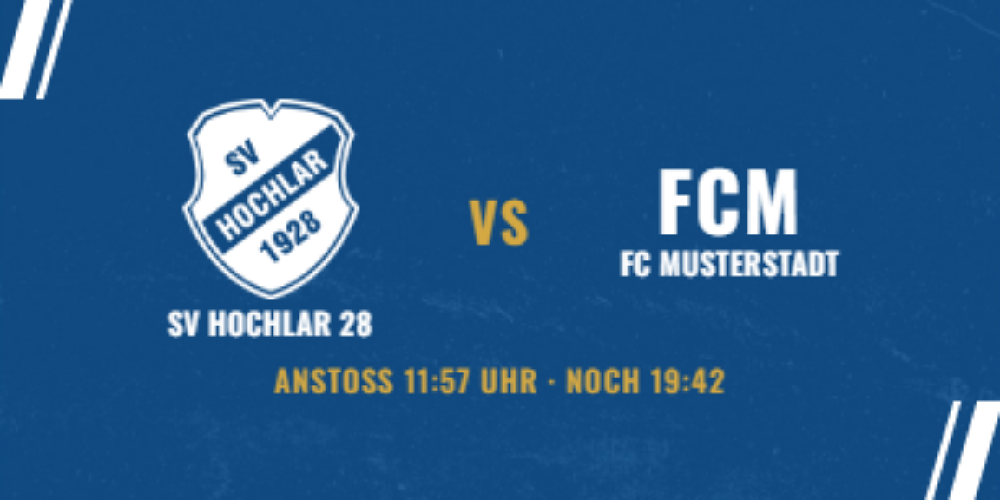
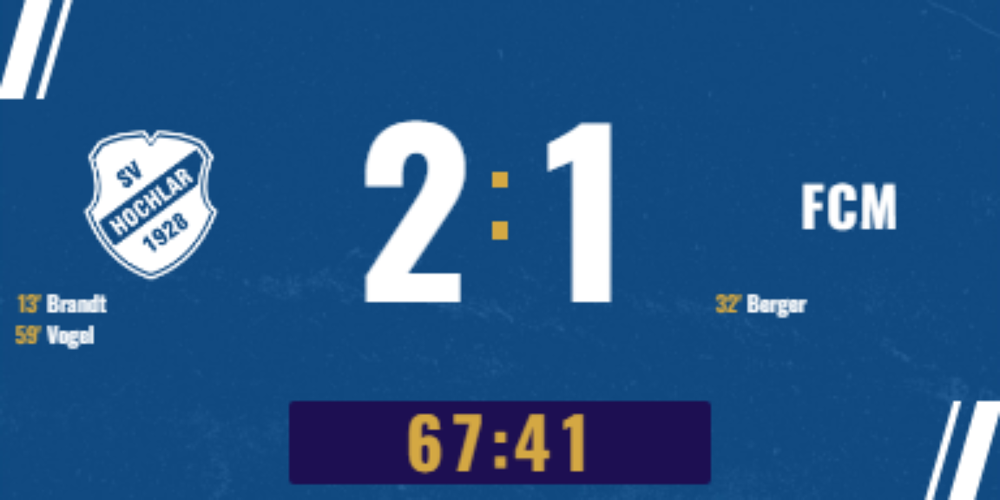
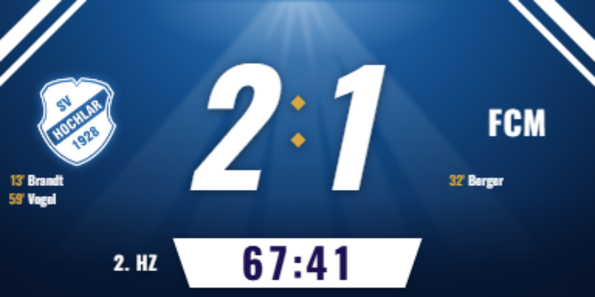
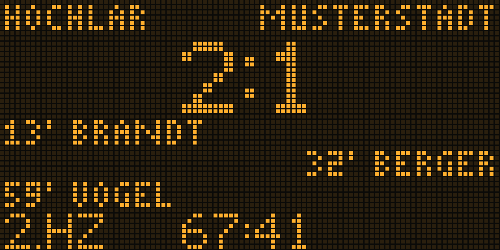
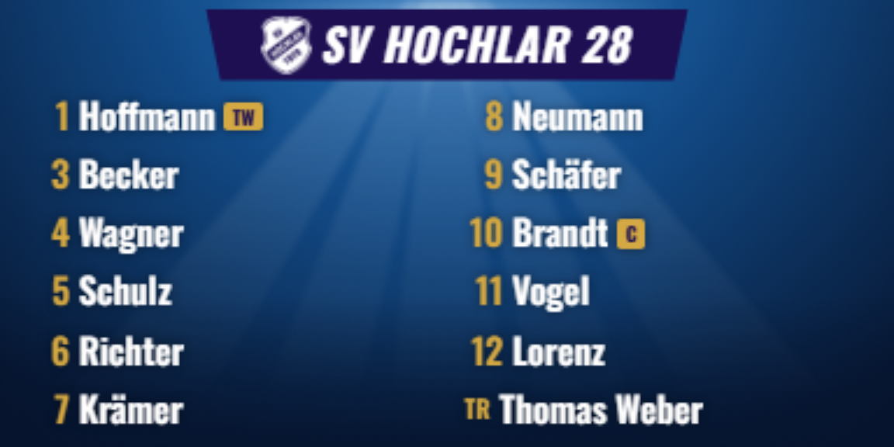
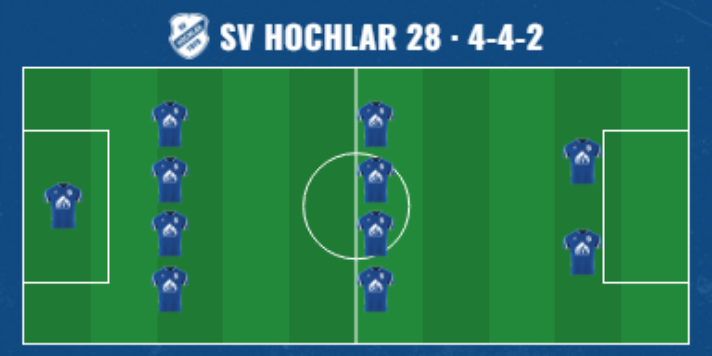

# Segensberg-Tafel

Steuerungssoftware für die LED-Anzeigetafel des **SV Hochlar 28** am
Segensberg in Recklinghausen. Ein Laptop steuert die Tafel per HDMI, ein
iPad kann im WLAN als Fernbedienung dazukommen.



| | |
|---|---|
|  |  |
| Begegnung vor dem Anpfiff | Spielstand im Design „Klassisch“ |
|  |  |
| Design „Flutlicht“ | Design „Retro“ als Punktmatrix |
|  |  |
| Torjubel | Aufstellung |
|  | |
| Aufstellung auf dem Spielfeld | |

Die Bilder zeigen die Anzeige in dreifacher Größe (Tafel: 384 × 192
Bildpunkte). Spieler und Gegner sind erfunden.

## Was sie kann

- **Spielbetrieb:** Spielstand, Uhr mit Nachspielzeit, Spielphasen mit
  Rückweg, Tore mit Torschützen (auch Eigentor und Strafstoß), Karten,
  Wechsel, Ecken, Elfmeterschießen. Ein laufendes Spiel übersteht einen
  Absturz.
- **Anzeige:** drei Designs (Klassisch, Flutlicht, Retro-Punktmatrix),
  Torjubel, Torschützen mit Portrait, Begegnung mit Wettbewerbslogo,
  Aufstellung als Übersicht, einzeln oder auf dem Spielfeld,
  Endstand mit Torschützenliste.
- **Diashow und Sponsoren:** Partner, Highlights, Vereinsgeschichte und
  Termine als abhakbare Blöcke, „präsentiert von"-Plätze für Aufstellung,
  Halbzeit, Torjubel, Ecken und Spieltagssponsor.
- **Bedienung:** Steuerungsfenster am Laptop, Fernsteuerung vom iPad im
  WLAN (mit PIN), einstellbare Standzeiten.
- **Verbindung zur Tafel:** Der Laptop findet den NovaStar-Taurus-Controller
  der Tafel im WLAN, zeigt an, ob die Tafel das Laptop-Bild zeigt, und
  regelt Helligkeit und HDMI-Umschaltung.

Die Anzeige rechnet in der Auflösung der LED-Wand (Standard 384 × 192)
und zeigt im Vorschaufenster dasselbe Bild wie die Tafel.

## Aufbau

| Ordner | Inhalt |
|---|---|
| [`laptop-app/`](laptop-app/) | Die eigentliche Anwendung (Electron, TypeScript). Funktionsumfang, Datenablage, Bauen und Ausliefern in [`laptop-app/README.md`](laptop-app/README.md). |
| [`controller-app/`](controller-app/) | Android-Grundgerüst für eine spätere App direkt auf dem Controller. |
| [`DESIGN.md`](DESIGN.md) | Gestaltungsregeln der Anzeige: Vereinsfarben, Schriften, Regeln für LED-Wände. |
| [`CHANGELOG.md`](CHANGELOG.md) | Was sich je Fassung geändert hat. |

Vereinsdaten (Kader mit Portraits, Logos der Ligavereine, Sponsorenmotive,
Tormusik) liegen bewusst **nicht** im Repository. Die App liest sie aus
einem Ordner `Vereinsdaten/`, siehe `laptop-app/README.md`.

Einige Dokumente verweisen auf `CLAUDE.md`, `Backlog.md` oder weitere
Planungsdokumente. Das sind interne Arbeitsnotizen, die nicht
veröffentlicht sind.

## Schnellstart

```bash
cd laptop-app
npm install
npm start        # bauen und starten
npm test         # Tests (ohne Electron, rund zehn Sekunden)
npm run dist     # Windows-Installer und portable .exe nach release/
```

## Lizenz

Der Code steht unter der [MIT-Lizenz](LICENSE). Ausgenommen sind das
Vereinswappen des SV Hochlar 28 und die Trikotbilder mit Sponsorlogo; die
Schriften stehen unter der SIL Open Font License. Fremder Code ist in
[`laptop-app/THIRD-PARTY-NOTICES.md`](laptop-app/THIRD-PARTY-NOTICES.md)
aufgeführt.
